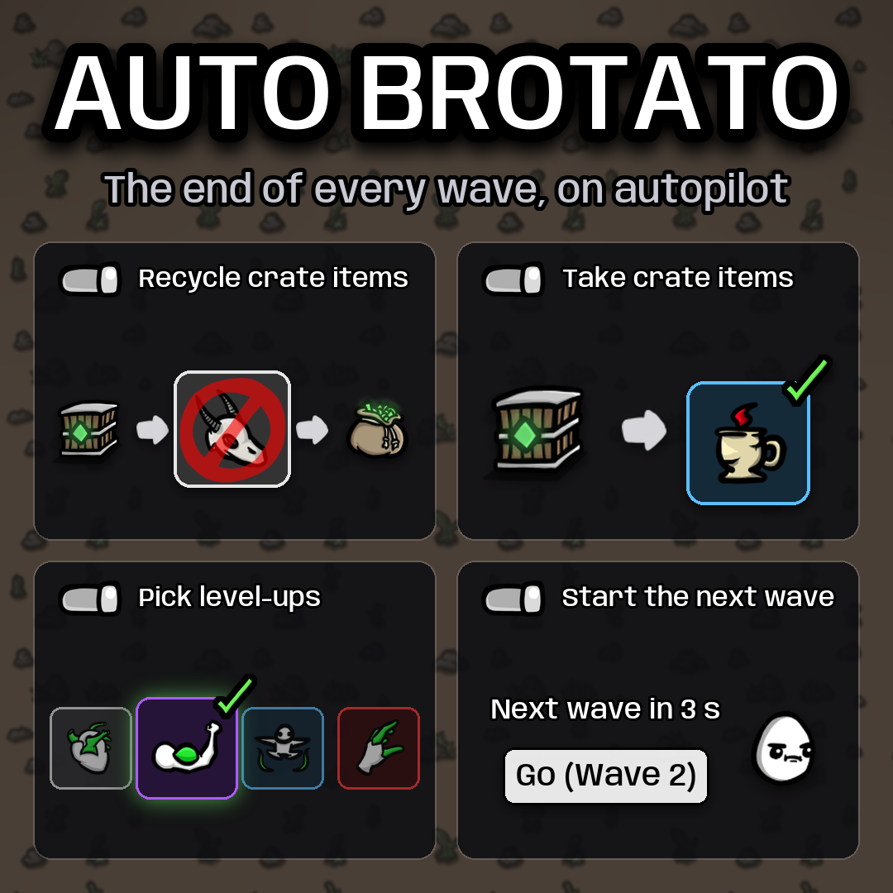

# Brotato Mods

Collection of mods for the game [Brotato](https://store.steampowered.com/app/1942280/Brotato/).

> **IMPORTANT:** You use mods at your own risk. I am not responsible for any issues or damage caused by using mods.

---

## Installation

Subscribe to a mod on its Steam Workshop page and start Brotato: the game's built-in mod loader loads every Workshop item you are subscribed to. Unsubscribe to remove it again. The **Mods** button in the main menu lists the loaded mods.

---

## Overview

Every mod in this repository has its own README with all its settings, linked from its heading below.

| Mod | Author | Description |
| --- | ------ | ----------- |
| [Auto Brotato](#auto-brotato-der_floh-auto_brotato) | der_floh | Recycles unwanted crate items, takes wanted ones, picks level-ups by weight and starts the next wave, each switchable on its own |

---

## Mods by me

### [Auto Brotato](src/der_floh/der_floh-auto_brotato/README.md) (`der_floh-auto_brotato`)

<a href="https://steamcommunity.com/sharedfiles/filedetails/?id=3846794587"></a>

Subscribe on the [Steam Workshop](https://steamcommunity.com/sharedfiles/filedetails/?id=3846794587).

Takes over the routine clicks at the end of a wave: it recycles crate items you don't want, takes the ones you do, picks level-ups by weight and starts the next wave, after an optional countdown that Esc cancels. Each of the four is switched on and off on its own, and all are off until you switch them on. It only presses the game's own buttons, so everything after the click works as if you had clicked yourself.

Open the settings with the **Auto Brotato** button in the pause menu or on the title screen; with dami's or Oudstand's Mod Options, the switches and sliders also appear under Options → Mods. The **Crate items** page sets which items are recycled, and the **Level-ups** page how likely each level-up is picked.

| Setting | Default | Description |
| --- | --- | --- |
| Recycle unwanted crate items | Off | Recycles crate items you crossed out, and cursed-only items that aren't cursed enough |
| Take wanted crate items | Off | Takes every other crate item |
| Pick level-ups | Off | Picks one of the offered level-ups by their weights |
| Start the next wave | Off | Presses Go in the shop |
| Next wave delay | `0 s` | Waits up to 10 seconds first, with a countdown above the Go button; Esc cancels it for this shop |
| Last wave to start | `0` | Stops starting waves after this wave; `0` never stops |

---

## Repository layout

| Folder | Contents |
| --- | --- |
| `src/<author>/<namespace>-<name>/` | One mod each: `manifest.json`, `mod_main.gd`, `README.md`, `changelog.md`, its scripts and assets, and `media/` with the images for its Workshop page. |
| `src/ThirdParty/` | Other authors' mods for reference and compatibility tests; see [Third-party mods](#third-party-mods). |
| `.vscode/build/` | Build and validation scripts. |
| `.github/` | GitHub workflows, `publish-workshop.ps1`, which uploads a release to the Steam Workshop, and `workshop-items.json`, the Workshop item of every published mod. |
| `tests/` | Integration tests that run inside the game, and the harness that drives it. |

## Building from source

[`.vscode/build/build.ps1`](.vscode/build/build.ps1) packs every mod in `src/<author>/<mod>/` (except `src/ThirdParty/`) into `out/<author>/<namespace>-<name>-<version>.zip` with the layout Godot Mod Loader expects, and writes each mod's Workshop description to `out/workshop/`. [`.vscode/build/validate.ps1`](.vscode/build/validate.ps1) then checks that every zip is in the folder of its mod's author, matches its source folder and has the layout and manifest that GML 6.3, the mod loader Brotato ships, accepts.

```powershell
./.vscode/build/build.ps1
./.vscode/build/validate.ps1
```

Both work with PowerShell 7 (`pwsh`) on Windows, Linux and macOS, and with the Windows PowerShell 5.1 that ships with Windows. Pass `-OutputDirectory <folder>` to build somewhere else and `-ZipDirectory <folder>` to validate that folder. As long as `src/` has no mods, run the build with `-AllowEmpty`. If Windows PowerShell refuses to run scripts, start it with `powershell -ExecutionPolicy Bypass -File .vscode\build\build.ps1`.

In VS Code, **Ctrl+Shift+B** runs the build, and **Tasks: Run Test Task** builds and then validates.

Every mod folder has a `README.md`, which is packed into the zip like the mod's other files. [`.vscode/build/workshop-descriptions.ps1`](.vscode/build/workshop-descriptions.ps1) converts it into the BBCode of the Steam Workshop: headings become `[h1]` to `[h3]`, tables stay tables and relative links point to the file on GitHub. The build runs it after packing; run it on its own, or the **Workshop descriptions** task, to regenerate only the descriptions.

## Publishing

[`ci.yml`](.github/workflows/ci.yml) builds and validates every push to `main` and every pull request and keeps the zips as an artifact. Both workflows use the shared [Mod CI and Mod Publish workflows](https://github.com/Der-Floh/Der-Floh/blob/main/.github/CI.md). A release reaches players in two steps:

1. **GitHub release.** Bump the `version_number` of every changed mod, add a section for that version to its `changelog.md`, and publish a GitHub release with a version tag such as `v1.2.0`. [`publish.yml`](.github/workflows/publish.yml) builds and validates the tag and attaches every mod's zip to the release, attested.
2. **Steam Workshop.** On your PC, run [`.github/publish-workshop.ps1`](.github/publish-workshop.ps1). It lists the releases, newest first, with each mod's version and the one [`.github/workshop-items.json`](.github/workshop-items.json) records as uploaded, and asks which release to upload (`-Tag` picks one). It uploads every mod of that release whose version differs, with the version's changelog section as change note, then records the item id and the uploaded version; commit that file.

```powershell
./.github/publish-workshop.ps1 -DryRun
./.github/publish-workshop.ps1 -SteamUser <account>
```

Without `-SteamUser` or the `STEAM_USER` environment variable, the upload asks for your Steam account name.

The Workshop gets exactly the zip attached to the release: the script downloads it with [GitHub CLI](https://cli.github.com/) and refuses it unless `gh attestation verify` confirms the release workflow built it. Its README and changelog come from inside the zip too, so they match the released version. The upload uses [SteamCMD](https://developer.valvesoftware.com/wiki/SteamCMD), which asks for your password and Steam Guard code the first time and then reuses the saved login. Its login replaces your Steam client's session, and the client doesn't reconnect by itself, so reconnect it afterwards. Your login never leaves your PC. An existing item keeps the title, description, preview image, tags and visibility of its Workshop page (`-UpdateDescription` replaces the description with the converted README). A mod without an item gets a new hidden one, titled with its README heading and with `media/preview.png` as preview image. Make it public on its Workshop page.

SteamCMD can't set tags, so a new item gets them once from Brotato's own uploader, `GodotWorkshopUtility.exe` in the game folder, which offers the tags in the game's `steam_data.json` (at most 5). Start it with Brotato's app id, so it can reach Steam:

```powershell
$env:SteamAppId = '1942280'; & '<Steam library>\steamapps\common\Brotato\GodotWorkshopUtility.exe'
```

Give it the item's Workshop ID, the tags and the release's zip. Always fill in the Workshop ID, or it creates another item. It also uploads the zip again and sets the item's title to the zip's file name, so pick a copy of the release zip named after the mod's title, such as `Auto Brotato.zip`. Later uploads with the script keep the tags.

## Integration tests

[`tests/run-integration.ps1`](tests/run-integration.ps1) starts Brotato with the mods and checks, inside the running game, that each mod does what its README says: alone, with all mods in `src/` at once, and in the combinations its suite declares. The tests need the game and Steam, so they run only locally, never in GitHub's workflows. [tests/README.md](tests/README.md) explains running them and writing new ones, and [tests/harness/README.md](tests/harness/README.md) the harness they use to drive the game.

```powershell
./tests/run-integration.ps1
```

In VS Code, the **Integration tests** task runs them.

## Third-party mods

`src/ThirdParty/` holds other authors' mods, for reading their code and for testing compatibility with them. Only [`ThirdParty-Mods.csv`](src/ThirdParty/ThirdParty-Mods.csv), with each mod's name, author and URL, is tracked; everything else in the folder is ignored by git, and the build, the validation and publishing skip it. Never edit a mod there. [`tests/fetch-third-party.ps1`](tests/fetch-third-party.ps1) puts each listed mod there as a zip Godot Mod Loader can load: from its latest GitHub release, or from Steam's download of a Workshop item you are subscribed to.

```powershell
./tests/fetch-third-party.ps1
```
